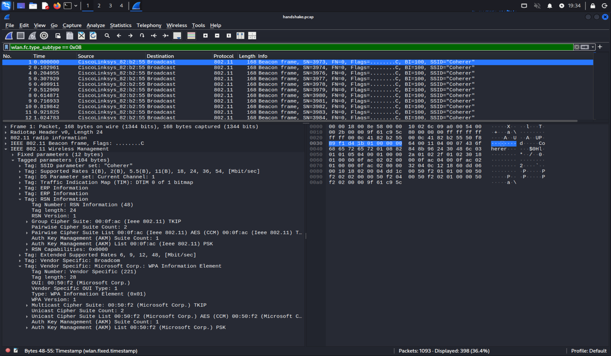
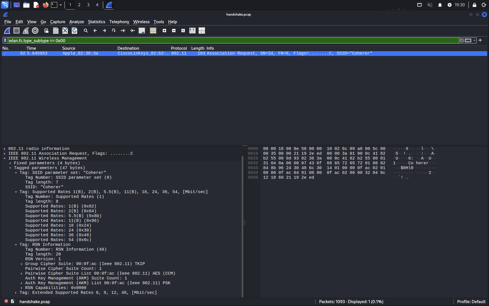
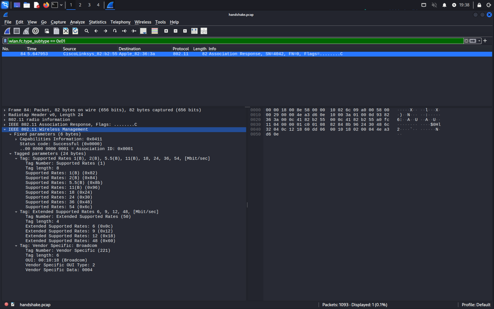
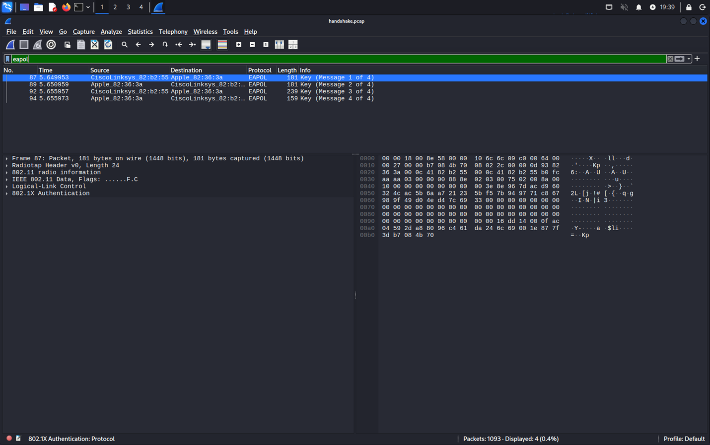

# Wireless Security Assessment and Offline Passphrase Analysis

An authorized graduate cybersecurity lab demonstrating how Wi-Fi management frames, a four-way handshake, and offline dictionary testing reveal a network's security configuration—and how defenders can interpret that evidence.

## Contents

- [Overview](#overview)
- [Tools and Technologies](#tools-and-technologies)
- [Lab Architecture](#lab-architecture)
- [Implementation](#implementation)
- [Troubleshooting](#troubleshooting)
- [Validation and Results](#validation-and-results)
- [Defensive Analysis](#defensive-analysis)
- [What I Learned](#what-i-learned)
- [Screenshots](#screenshots)

## Overview

I completed this exercise using an instructor-provided packet capture from an authorized university lab. The assignment involved identifying the security protocol used by the network, examining the client connection process, and recovering a lab passphrase through offline testing.

I analyzed the supplied capture in Wireshark and tested candidate passphrases with Aircrack-ng on Kali Linux. The instructor had already captured the wireless traffic; I did not perform live wireless capture, deauthentication, or a connection to the target access point.

This public write-up omits the recovered passphrase, derived key material, student identifiers, and the original capture. It documents the investigation and results without publishing the course's recovered credential.

## Tools and Technologies

- Kali Linux
- Wireshark and IEEE 802.11 display filters
- Aircrack-ng 1.7
- WPA/WPA2-Personal, RSN, PSK, AES-CCMP, and TKIP
- EAPOL four-way handshake analysis
- RockYou candidate wordlist
- Python 3 for capitalization variants
- Linux text utilities: `gzip`, `grep`, `sort`, `wc`, and `head`

## Lab Architecture

The evidence came from one supplied wireless capture. I followed two related paths through it:

| Evidence | Analysis | Purpose |
|---|---|---|
| Beacon frames | Advertised RSN and WPA information | Identify security options supported by the AP |
| Association Request | Client-selected cipher and authentication suite | Identify the requested connection settings |
| Association Response | Status code | Check whether the AP accepted association |
| EAPOL-Key messages | Four-way handshake | Understand key establishment and provide evidence for offline candidate verification |
| Candidate dictionaries | Local Aircrack-ng testing | Determine whether a candidate matches the captured handshake |

The offline testing used the capture as input and did not send password attempts to a live access point.

## Implementation

### Identifying Advertised Security

I first filtered for the lab SSID and then inspected beacon frames:

```text
wlan.ssid == "Coherer"
wlan.fc.type_subtype == 0x08
```

The beacon contained both an RSN Information element and a vendor-specific WPA Information Element. This indicated WPA/WPA2 compatibility rather than a single advertised security option.

The RSN element advertised PSK authentication, AES (CCM) and TKIP as pairwise options, and TKIP as the group cipher. The separate WPA element advertised original WPA support.

An important distinction was that `RSN Version: 1` describes the information-element format. It does not identify the connection as WPA version 1.

### Checking the Client's Selection

I used the following display filter to inspect Association Requests:

```text
wlan.fc.type_subtype == 0x00
```

Frame 82 contained an RSN element with one pairwise cipher and one authentication suite:

| Setting | Client selection |
|---|---|
| Security protocol | WPA2-Personal / WPA2-PSK |
| Pairwise cipher | AES-CCMP, displayed as AES (CCM) |
| Group cipher | TKIP |
| Authentication/key management | PSK |

AES-CCMP and TKIP served different roles in this connection. The pairwise cipher protected individual client–AP traffic, while the group cipher protected AP broadcast and multicast traffic.

I then inspected the Association Response:

```text
wlan.fc.type_subtype == 0x01
```

Frame 84 reported `Successful (0x0000)`. This established that the AP accepted association; it did not by itself prove that the client possessed the shared secret.

### Examining the Four-Way Handshake

The `eapol` filter isolated four EAPOL-Key messages:

| Message | Frame | Main role |
|---|---|---|
| 1 | 87 | AP supplies its nonce, ANonce |
| 2 | 89 | Client supplies SNonce and a MIC, allowing the AP to derive key material and check client key possession |
| 3 | 92 | AP supplies a MIC and protected key data, including the group key |
| 4 | 94 | Client acknowledges completion with a MIC |

In passphrase-based WPA2-Personal, the passphrase and SSID are used to derive a Pairwise Master Key. The PMK, the two nonces, and the AP/client MAC addresses are then used to derive session-specific Pairwise Transient Key material.

Neither the passphrase nor the PMK is transmitted in the handshake. However, the capture contains enough information to derive keys from a candidate passphrase and compare a calculated MIC with the recorded message.

### Preparing and Testing Candidates

The assignment provided a constraint: an English word, possibly containing capital letters, with a length of 8–10 characters.

I extracted the RockYou dictionary and filtered it to unique entries containing only 8–10 ASCII letters. The resulting dictionary contained **1,773,415 candidates**. This enforced a character set and length, but did not establish that every entry was an English word.

I tested that dictionary against the captured handshake using Aircrack-ng. The initial run exhausted the list without finding a match.

### Expanding Capitalization

I used Python to generate three forms of each candidate:

- Lowercase: `word.lower()`
- Initial capital: `word.capitalize()`
- Uppercase: `word.upper()`

A set removed duplicate variants. The resulting file contained **5,085,381 candidates**.

This was a replacement candidate set built from three common capitalization patterns. It did not enumerate every possible mixed-case spelling, and arbitrary mixed-case originals were not necessarily retained.

The second run recovered a nine-character lab passphrase. I then created a dictionary containing only that candidate and repeated the offline verification.

## Troubleshooting

| Issue | Investigation and resolution | Lesson |
|---|---|---|
| Beacon contained both RSN and WPA entries | Inspected the Association Request to identify the client's selected settings | Advertised support is different from the protocol selected for a particular connection |
| AES and TKIP both appeared in the client request | Checked the pairwise and group cipher labels separately | Read a value in the context of its field rather than treating every cipher as an alternative |
| RSN Version 1 appeared in a WPA2 connection | Distinguished the element's format version from the security protocol generation | Similar-looking version fields can describe different layers |
| Initial dictionary returned `KEY NOT FOUND` | Generated common capitalization variants and repeated the test | An exhausted dictionary establishes only that its candidates did not match |
| Needed to verify the recovered candidate | Re-tested a one-entry dictionary against the same capture | Document exactly what verification establishes and which tool performed it |

## Validation and Results

I verified:

- WPA and WPA2 support advertised in the beacon.
- WPA2-Personal selection in the client's RSN Association Request.
- AES-CCMP pairwise protection, TKIP group protection, and PSK authentication.
- A successful Association Response.
- Four EAPOL-Key messages in the capture.
- Exhaustion of the initial dictionary.
- Recovery using capitalization variants.
- A successful one-candidate re-test against the capture.

| Test | Recorded result |
|---|---|
| Initial dictionary | 1,773,415 candidates tested; no match; approximately 3 minutes 1 second |
| Capitalization variants | Match found after 1,344,184 of 5,085,381 candidates; approximately 2 minutes 17 seconds |
| One-candidate verification | 1 of 1 candidate tested; match confirmed |

These timings describe the recorded runs, not a general performance benchmark. The passphrase and derived keys are intentionally omitted from this repository.

The final verification used the same tool and capture. It was not independent-tool validation or a live connection test. The result demonstrated recovery of a guessable passphrase, not a break of AES encryption.

## Defensive Analysis

The points below describe defensive implications, not controls or detections I deployed during this lab.

### Wireless Configuration Review

An analyst should inspect both advertised capabilities and negotiated settings. A network advertising WPA2 may still allow legacy security options, and its group cipher can differ from its pairwise cipher.

Useful checks include:

- Whether legacy WPA or TKIP compatibility remains enabled.
- Which authentication/key-management suites the AP advertises.
- Which cipher and authentication suite a client selects.
- Whether association succeeds and the expected key exchange follows.

Modernizing an AP configuration should include checking device compatibility and removing legacy options where supported.

### Passphrase Strength and Offline Exposure

A short dictionary word remains guessable when its initial letter is capitalized. The successful second attempt illustrated why common capitalization patterns add little resistance to a targeted dictionary attack.

A long, randomly generated passphrase provides stronger protection against this form of guessing. Where appropriate, organizations can evaluate WPA3-Personal or managed enterprise authentication rather than depending on a shared dictionary-word secret.

### Monitoring Limitations

Offline candidate testing happens on the analyst's machine. The AP does not receive each candidate, so ordinary failed-login counters cannot reveal the number of offline guesses.

Wireless monitoring can help investigate live activity such as unexpected association patterns or deauthentication traffic, but those events were not part of my testing. This capture does not establish that a live attack occurred.

## What I Learned

This lab strengthened my ability to interpret Wi-Fi management frames, distinguish advertised capabilities from negotiated settings, and connect packet evidence to an offline verification process.

The most useful troubleshooting lesson was to treat an unsuccessful dictionary run as information about the tested candidate set. Changing the capitalization strategy produced a different result without changing the capture or target.

For network-security and SOC work, the exercise reinforced the need to separate observed facts from broader conclusions. Successful association did not prove key possession, a dictionary failure did not establish password strength, and recovering a passphrase did not mean the encryption algorithm had been broken.

I used ChatGPT to help explain protocol fields, suggest filters and commands, generate the capitalization script, and organize the write-up. I ran the lab steps and checked the results in Wireshark and Aircrack-ng. AI assistance was also disclosed in my course report.

## Screenshots

These screenshots were extracted from my course report. They show the authorized lab network's protocol evidence. Terminal screenshots containing the recovered passphrase and derived keys, along with student-identifying report pages, are not included.

### Advertised Security Options



The AP advertised both RSN and original WPA information. The beacon described supported options rather than a particular client's selected settings.

### Client Association Request



Frame 82 selected one pairwise cipher, AES-CCMP, while retaining TKIP as the group cipher.

### Association Accepted



Frame 84 reported a successful association. The four-way handshake followed this step.

### Four-Way Handshake



Frames 87, 89, 92, and 94 show messages 1–4 of the key exchange used for the offline analysis.
